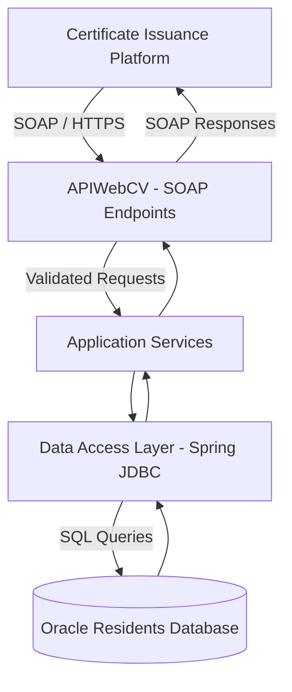

# APIWebCV — SOAP Integration Service

### Technical Case Study | Ajuntament de Sóller

APIWebCV is a Java-based SOAP web service developed for the Ajuntament de Sóller (Mallorca, Spain) to support the remote issuance of resident travel certificates.

The service integrates the Consell de Mallorca's certificate platform with the municipality's Oracle residents database, providing standardized and secure access to the information required by the external system.

**Project type:** Professional development  
**Role:** Backend / API Developer  
**Period:** 2025–2026  
**Status:** Deployed in production

> **Note:** This is a documentation-only technical case study. The original source code and infrastructure configurations are private and are not included in this repository.

## 1. Project Overview

### The Problem

The Consell de Mallorca introduced a centralized platform allowing residents to request travel certificates online.

However, municipal administrations maintain their own resident databases, with different internal structures and implementations.

An integration layer was therefore required to provide a standardized interface between the external platform and each municipality's existing systems.

### The Solution

APIWebCV was developed as a SOAP integration service that:

- Exposes a standardized XML-based interface.
- Authenticates requests using a ticket-based mechanism.
- Validates incoming messages against an XML Schema.
- Retrieves the required information from an Oracle database.
- Returns structured SOAP responses with standardized transaction status information.
- Supports the retrieval of municipal resources required for certificate generation.

## 2. Technology Stack

| Area | Technologies |
|---|---|
| Language | Java 17 |
| Framework | Spring Boot |
| Web Services | Spring Web Services, SOAP/XML |
| Contracts | WSDL, XSD, JAXB |
| Data Access | Spring JDBC |
| Database | Oracle Database |
| Build | Maven |
| Application Server | Embedded Apache Tomcat |
| Operating System | Oracle Linux |
| Deployment | systemd, HTTPS/TLS |
| Testing | SoapUI |

## 3. System Architecture

The application follows a layered architecture, separating SOAP message processing, application logic, and database access.

The following diagram represents the main logical components. It is a simplified illustration rather than the internal deployment topology.

### Application Layers

**SOAP Endpoint Layer**

Handles incoming SOAP messages, XML validation, authentication checks, and response generation.

**Application Service Layer**

Encapsulates the business logic required to process requests and coordinate operations.

**Persistence Layer**

Uses Spring JDBC to execute SQL queries against the Oracle residents database and map the results into Java objects.

## 4. Key Engineering Features

### Contract-Based SOAP Integration

The service uses XML Schema definitions to establish the structure of requests and responses.

JAXB supports the conversion between XML documents and Java objects, while Spring Web Services handles SOAP message processing.

Incoming requests are validated against the expected XML structure before being processed.

### Authentication and Request Validation

A ticket-based authentication mechanism controls access to protected operations.

The application also implements request validation and structured error handling to distinguish successful transactions from validation, authentication, and processing failures.

### Oracle Database Integration

The persistence layer uses Spring JDBC for database access.

Database operations are isolated from the SOAP endpoint and application-service layers, keeping transport concerns separate from data access.

### Deployment and Operations

The application was deployed in an Oracle Linux environment using:

- Spring Boot with embedded Tomcat.
- A dedicated Linux service account with restricted permissions.
- systemd for service management.
- HTTPS/TLS for encrypted communication.
- Environment-specific application configuration.
- Logging configurations for development and production.

## 5. Engineering Challenges

### SOAP Contract Compatibility

Ensuring interoperability between the external certificate platform and the municipal backend required careful handling of XML structures, schema validation, and response formatting.

### Database Environment Compatibility

Development required an isolated Oracle environment with test data.

Differences between development and production database configurations had to be addressed during integration and deployment.

### Linux Service Deployment

Moving the application into production involved configuring the Java runtime, managing service permissions, and troubleshooting environment-specific startup and database-access issues.

## 6. Project Outcome

APIWebCV was successfully developed and deployed as a production SOAP integration service for the Ajuntament de Sóller.

The service supports the municipality's participation in the remote travel-certificate issuance process, enabling the external platform to obtain the necessary information through a standardized integration interface.

The project involved the complete backend development lifecycle, from database and integration setup to application development, testing, and production deployment.

## 7. Source Code and Confidentiality

APIWebCV was developed professionally for the Ajuntament de Sóller.

The original implementation, internal configurations, database structures, and operational details are not publicly available.

This repository documents the project's engineering approach and technical experience without distributing the original application.

---

**Developer:** Josep Méndez  
**Specialization:** Java Backend Development, API Integration, SQL Databases, Linux Deployment
